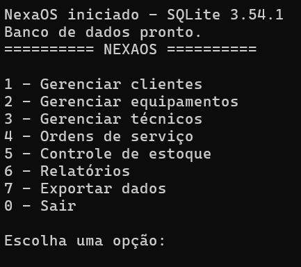
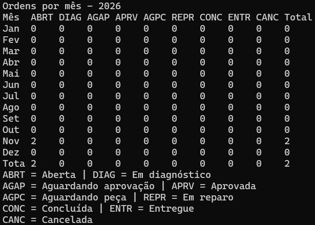

# NexaOS

Sistema de terminal para registrar ordens de serviço de uma empresa fictícia de assistência técnica.
Desenvolvido em C11 para Windows, com persistência local em SQLite.

## Demonstração





## Início rápido

No PowerShell, na pasta raiz do repositório:

```powershell
cd C:\caminho\NexaOS
.\build.bat app
.\build.bat run
.\build.bat test
```

## Apresentação

O NexaOS organiza clientes, equipamentos, técnicos, ordens de serviço, peças,
estoque e relatórios em uma aplicação de terminal.

## Objetivo do sistema

O objetivo é apoiar o registro e o acompanhamento do atendimento técnico:
desde o cadastro do cliente e do equipamento até a situação da ordem, o consumo
de peças e a consulta ou exportação de relatórios.

## Tecnologias utilizadas

- C11 e biblioteca padrão C.
- SQLite 3 pela API C.
- GCC do ambiente MSYS2 UCRT64.
- Aplicação de terminal para Windows.

## Pré-requisitos

- Windows.
- MSYS2 com o ambiente UCRT64, GCC e SQLite 3.
- Git para clonar o repositório.
- VS Code e DB Browser for SQLite são opcionais.

## Instalação e configuração

1. Instale o MSYS2 pelo instalador oficial e abra o terminal **MSYS2 UCRT64**.
2. Instale o compilador, a biblioteca SQLite e seus cabeçalhos:

   ```sh
   pacman -S --needed mingw-w64-ucrt-x86_64-gcc mingw-w64-ucrt-x86_64-sqlite3
   ```

3. Adicione `C:\msys64\ucrt64\bin` à variável `Path` do Windows. Feche e abra
   novamente os terminais após alterar o `Path`.
4. No PowerShell, confira a instalação:

   ```powershell
   gcc --version
   ```

5. Clone o endereço do repositório fornecido para o projeto e entre na pasta:

   ```powershell
   git clone URL_DO_REPOSITORIO NexaOS
   cd NexaOS
   ```

   Substitua `URL_DO_REPOSITORIO` pelo endereço real disponibilizado para o
   repositório.

## Compilação e execução

Execute os comandos a partir da pasta raiz do repositório, pois o aplicativo
procura `database/schema.sql` usando esse diretório como referência.

```powershell
.\build.bat app
```

Compila `src\main.c` e os módulos definidos em `MODULOS` para
`build\nexaos.exe`.

```powershell
.\build.bat run
```

Compila e inicia o aplicativo. O banco de dados da aplicação fica em
`data\nexaos.db`.

```powershell
.\build.bat test
```

Compila e executa cada arquivo `tests\test_*.c`. A execução termina com
`TESTES OK` se todos os testes passarem.

## Executável pronto (Windows)

Na aba **Releases** do GitHub, baixe `NexaOS_v1.0.zip`, extraia a pasta e
execute `Iniciar_NexaOS.bat`. O banco será criado em `data\nexaos.db`.

## Funcionalidades

- **Clientes:** cadastro, consulta, atualização e listagem.
- **Equipamentos:** cadastro e consulta, incluindo filtro por cliente.
- **Técnicos:** cadastro, consulta e listagem.
- **Ordens de serviço:** abertura, consulta, listagem, técnico, diagnóstico,
  observações, histórico e atualização de situação.
- **Estoque:** cadastro e consulta de peças, entradas, saídas, estoque baixo e
  movimentações.
- **Peças nas ordens:** registro e consulta de peças consumidas.
- **Relatórios:** resumo e ordens por mês, peças com estoque baixo e
  movimentações.
- **Exportação CSV:** relatórios e movimentações em arquivos separados por
  ponto e vírgula, na pasta `exports`.

## Instruções de utilização

Um fluxo típico é:

1. Cadastre o cliente.
2. Cadastre o equipamento vinculado ao cliente.
3. Cadastre ao menos um técnico.
4. Abra a ordem, escolhendo cliente, equipamento e, opcionalmente, um técnico.
5. Atribua o técnico antes de passar a ordem para `EM_DIAGNOSTICO`.
6. Registre o diagnóstico antes de concluir a ordem.
7. Atualize as situações conforme o atendimento. O fluxo definido no código é:
   `ABERTA` → `EM_DIAGNOSTICO` → `AGUARDANDO_APROVACAO` → `APROVADA` →
   `AGUARDANDO_PECA` ou `EM_REPARO` → `CONCLUIDA` → `ENTREGUE`. Há transições
   permitidas para cancelamento, que exige um motivo.
8. Use peças apenas quando a ordem estiver em `APROVADA`,
   `AGUARDANDO_PECA` ou `EM_REPARO`. A quantidade do estoque, a movimentação,
   o item da ordem e o evento de histórico são gravados na mesma transação.
9. Consulte os relatórios ou exporte os resultados em CSV pelo menu principal.

As situações são códigos sem acentos no banco; a aplicação exibe rótulos
acentuados nas telas.

## Estrutura do projeto

```text
.
├── .github/
├── .vscode/
├── database/
│   ├── dados_exemplo.sql
│   └── schema.sql
├── data/
│   └── .gitkeep
├── docs/
│   ├── .gitkeep
│   ├── exemplo_historico_ordem.json
│   ├── guia_do_codigo.md
│   ├── modelo_de_dados.md
│   ├── nosql_mongodb.md
│   ├── requisitos_atendidos.md
│   └── revisao_de_memoria.md
├── exports/
│   └── .gitkeep
├── include/
│   ├── clientes.h
│   ├── db.h
│   ├── equipamentos.h
│   ├── exportacao.h
│   ├── historico.h
│   ├── itens_ordem.h
│   ├── menu_estoque.h
│   ├── menu_exportacao.h
│   ├── menu_itens_ordem.h
│   ├── menu_ordens.h
│   ├── menu_relatorios.h
│   ├── ordens.h
│   ├── pecas.h
│   ├── relatorios.h
│   ├── resultado.h
│   ├── tecnicos.h
│   └── util.h
├── src/
│   ├── clientes.c
│   ├── db.c
│   ├── equipamentos.c
│   ├── exportacao.c
│   ├── historico.c
│   ├── itens_ordem.c
│   ├── main.c
│   ├── menu_estoque.c
│   ├── menu_exportacao.c
│   ├── menu_itens_ordem.c
│   ├── menu_ordens.c
│   ├── menu_relatorios.c
│   ├── ordens.c
│   ├── pecas.c
│   ├── relatorios.c
│   ├── tecnicos.c
│   └── util.c
├── tests/
│   ├── test_clientes.c
│   ├── test_dados_exemplo.c
│   ├── test_db.c
│   ├── test_equipamentos.c
│   ├── test_exportacao.c
│   ├── test_itens_ordem.c
│   ├── test_ordens.c
│   ├── test_ordens_fluxo.c
│   ├── test_pecas.c
│   ├── test_relatorios.c
│   ├── test_tecnicos.c
│   ├── test_util.h
│   ├── test_validacao.c
│   └── vazamento.c
├── .gitignore
├── build.bat
└── README.md
```

`build/`, `data\nexaos.db` e os CSVs exportados são arquivos gerados e
ignorados pelo Git.

## Estrutura do banco de dados

O banco possui oito tabelas: `clientes`, `equipamentos`, `tecnicos`,
`ordens_servico`, `pecas`, `itens_ordem`, `historico_ordens` e
`movimentacoes_estoque`. O esquema cria chaves estrangeiras, restrições e
índices. Consulte o [modelo de dados](docs/modelo_de_dados.md) para detalhes.

## Dados de exemplo

`database\dados_exemplo.sql` contém clientes, equipamentos, técnicos, peças,
ordens, histórico, itens e movimentações fictícios. Ele deve ser executado em
um banco vazio que já tenha recebido o esquema. Não o carregue no banco da
aplicação se ele já tiver dados, pois as inserções usam IDs explícitos.

### SQLite pela linha de comando

O SQLite CLI foi conferido neste ambiente. Na pasta raiz, crie um banco vazio
e aplique primeiro o esquema e depois os dados de exemplo:

```powershell
sqlite3 data\exemplo.db ".read database/schema.sql"
sqlite3 data\exemplo.db ".read database/dados_exemplo.sql"
```

O comando `sqlite3` está disponível após a instalação do pacote SQLite indicado
acima e a configuração do `Path`.

### DB Browser for SQLite

O DB Browser é opcional e não foi localizado no `Path` deste ambiente. Caso
esteja instalado, abra um novo banco vazio, use a área **Execute SQL** para
abrir e executar `database/schema.sql`; em seguida, abra e execute
`database/dados_exemplo.sql` na mesma conexão. Confirme que a execução terminou
sem erro antes de consultar as tabelas.

## Testes realizados

`build.bat test` compila e executa 12 arquivos de teste. Na última execução:
**405 verificações passaram**, incluindo 12 verificações finais de memória, uma
por executável; não houve falhas e o resultado foi `TESTES OK`.

| Arquivo                      | Cobertura principal                                                                  |
| ---------------------------- | ------------------------------------------------------------------------------------ |
| `tests/test_clientes.c`      | Cadastro, validação, consulta, atualização, listagem e persistência de clientes.     |
| `tests/test_dados_exemplo.c` | Carga de dados de exemplo, contagens, chaves estrangeiras, saldos e relatórios.      |
| `tests/test_db.c`            | Esquema, chaves estrangeiras, restrições, erros SQLite e persistência.               |
| `tests/test_equipamentos.c`  | Cadastro, validação, consulta e listagem de equipamentos.                            |
| `tests/test_exportacao.c`    | Cabeçalhos, linhas, codificação, escaping, neutralização de fórmulas e erros de CSV. |
| `tests/test_itens_ordem.c`   | Uso de peças, regras de situação, transações, histórico e estoque.                   |
| `tests/test_ordens.c`        | Abertura, busca, listagem, histórico e alterações de ordem.                          |
| `tests/test_ordens_fluxo.c`  | Transições, regras de negócio, rollback e fluxo completo da ordem.                   |
| `tests/test_pecas.c`         | Cadastro, estoque, movimentações, validações, rollback e persistência de peças.      |
| `tests/test_relatorios.c`    | Resumo, matriz mensal, totais e ano atual.                                           |
| `tests/test_tecnicos.c`      | Cadastro, validação, consulta e listagem de técnicos.                                |
| `tests/test_validacao.c`     | Utilitários, validações, formatação e leitura de entradas.                           |

`tests/vazamento.c` envolve as funções de alocação no linker. O helper
`tests/test_util.h` verifica se restaram blocos alocados ao final de cada teste.

## Solução de problemas

- **Smart App Control ou Device Guard bloqueou o executável:** compile pelo
  `build.bat` e siga a política de segurança da organização. Não tente contornar
  a proteção; em um computador gerenciado, peça orientação ao administrador.
- **`gcc` não encontrado:** confirme que
  `C:\msys64\ucrt64\bin` está no `Path`, reabra o terminal e execute
  `gcc --version`.
- **`sqlite3.h` não encontrado:** abra o terminal MSYS2 UCRT64 e instale
  `mingw-w64-ucrt-x86_64-sqlite3` com `pacman`; confira também se o GCC usado é
  `C:\msys64\ucrt64\bin\gcc.exe`.
- **Acentos quebrados no console:** use o executável compilado para Windows
  pelo projeto; `src/main.c` configura entrada e saída do console para UTF-8.

## Limitações conhecidas

- O sistema não oferece exclusão de registros.
- Cancelar uma ordem não devolve automaticamente peças já consumidas.
- CPF e CNPJ são verificados pelo formato e pela quantidade de dígitos, sem
  validação do dígito verificador.
- Não há login, pagamentos ou integrações externas.
- O MongoDB não está integrado; o sistema usa SQLite.

## Documentação adicional

- [Guia do código](docs/guia_do_codigo.md)
- [Modelo de dados](docs/modelo_de_dados.md)
- [Requisitos atendidos](docs/requisitos_atendidos.md)
- [Revisão de memória e recursos](docs/revisao_de_memoria.md)
- [Comparação com MongoDB](docs/nosql_mongodb.md)
- [Exemplo de histórico em documento JSON](docs/exemplo_historico_ordem.json)

## Autor e contexto

Autor: Eduardo Romano
Projeto acadêmico PIM IV, UNIP.
Curso de Análise e Desenvolvimento de Sistemas.
Empresa fictícia: NexaFix.
