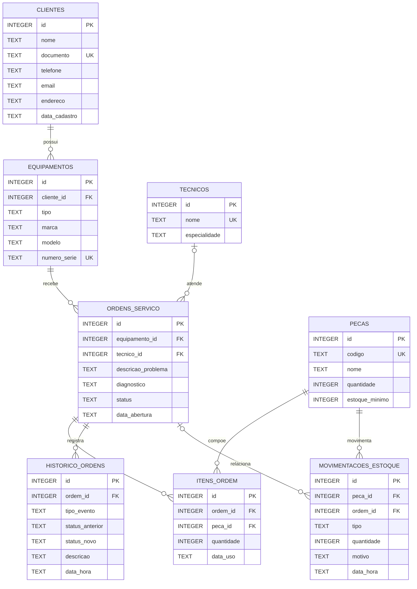

# Modelo de dados

O banco SQLite contém oito tabelas. As entidades de cadastro são referenciadas
pelas ordens; itens, histórico e movimentações registram atividades relacionadas.

## Diagrama ER

## Tabelas e restrições

As definições abaixo refletem [`database/schema.sql`](../database/schema.sql).
`INTEGER PRIMARY KEY AUTOINCREMENT` identifica cada registro; `NOT NULL` exige
um valor; `UNIQUE` impede repetição; `REFERENCES` declara uma chave estrangeira.

### `clientes`

| Coluna | Tipo | Chave e restrições |
|---|---|---|
| `id` | `INTEGER` | `PRIMARY KEY AUTOINCREMENT` |
| `nome` | `TEXT` | `NOT NULL` |
| `documento` | `TEXT` | `NOT NULL UNIQUE`; comentário do esquema: CPF ou CNPJ somente dígitos |
| `telefone` | `TEXT` | `NOT NULL` |
| `email` | `TEXT` | Opcional |
| `endereco` | `TEXT` | Opcional |
| `data_cadastro` | `TEXT` | `NOT NULL DEFAULT (datetime('now','localtime'))` |

### `equipamentos`

| Coluna | Tipo | Chave e restrições |
|---|---|---|
| `id` | `INTEGER` | `PRIMARY KEY AUTOINCREMENT` |
| `cliente_id` | `INTEGER` | `NOT NULL REFERENCES clientes(id)` |
| `tipo` | `TEXT` | `NOT NULL CHECK (tipo IN ('COMPUTADOR','NOTEBOOK','IMPRESSORA','OUTRO'))` |
| `marca` | `TEXT` | `NOT NULL` |
| `modelo` | `TEXT` | `NOT NULL` |
| `numero_serie` | `TEXT` | `NOT NULL UNIQUE` |

### `tecnicos`

| Coluna | Tipo | Chave e restrições |
|---|---|---|
| `id` | `INTEGER` | `PRIMARY KEY AUTOINCREMENT` |
| `nome` | `TEXT` | `NOT NULL UNIQUE` |
| `especialidade` | `TEXT` | `NOT NULL` |

### `ordens_servico`

| Coluna | Tipo | Chave e restrições |
|---|---|---|
| `id` | `INTEGER` | `PRIMARY KEY AUTOINCREMENT` |
| `equipamento_id` | `INTEGER` | `NOT NULL REFERENCES equipamentos(id)` |
| `tecnico_id` | `INTEGER` | `REFERENCES tecnicos(id)`; pode ser `NULL` |
| `descricao_problema` | `TEXT` | `NOT NULL` |
| `diagnostico` | `TEXT` | Opcional |
| `status` | `TEXT` | `NOT NULL DEFAULT 'ABERTA' CHECK` limitado aos códigos `ABERTA`, `EM_DIAGNOSTICO`, `AGUARDANDO_APROVACAO`, `APROVADA`, `AGUARDANDO_PECA`, `EM_REPARO`, `CONCLUIDA`, `ENTREGUE` e `CANCELADA` |
| `data_abertura` | `TEXT` | `NOT NULL DEFAULT (datetime('now','localtime'))` |

### `pecas`

| Coluna | Tipo | Chave e restrições |
|---|---|---|
| `id` | `INTEGER` | `PRIMARY KEY AUTOINCREMENT` |
| `codigo` | `TEXT` | `NOT NULL UNIQUE` |
| `nome` | `TEXT` | `NOT NULL` |
| `quantidade` | `INTEGER` | `NOT NULL DEFAULT 0 CHECK (quantidade >= 0)` |
| `estoque_minimo` | `INTEGER` | `NOT NULL DEFAULT 0 CHECK (estoque_minimo >= 0)` |

### `itens_ordem`

| Coluna | Tipo | Chave e restrições |
|---|---|---|
| `id` | `INTEGER` | `PRIMARY KEY AUTOINCREMENT` |
| `ordem_id` | `INTEGER` | `NOT NULL REFERENCES ordens_servico(id)` |
| `peca_id` | `INTEGER` | `NOT NULL REFERENCES pecas(id)` |
| `quantidade` | `INTEGER` | `NOT NULL CHECK (quantidade > 0)` |
| `data_uso` | `TEXT` | `NOT NULL DEFAULT (datetime('now','localtime'))` |

### `historico_ordens`

| Coluna | Tipo | Chave e restrições |
|---|---|---|
| `id` | `INTEGER` | `PRIMARY KEY AUTOINCREMENT` |
| `ordem_id` | `INTEGER` | `NOT NULL REFERENCES ordens_servico(id)` |
| `tipo_evento` | `TEXT` | `NOT NULL CHECK` limitado a `ABERTURA`, `STATUS`, `DIAGNOSTICO`, `OBSERVACAO`, `TECNICO` e `PECA` |
| `status_anterior` | `TEXT` | Opcional |
| `status_novo` | `TEXT` | Opcional |
| `descricao` | `TEXT` | Opcional |
| `data_hora` | `TEXT` | `NOT NULL DEFAULT (datetime('now','localtime'))` |

### `movimentacoes_estoque`

| Coluna | Tipo | Chave e restrições |
|---|---|---|
| `id` | `INTEGER` | `PRIMARY KEY AUTOINCREMENT` |
| `peca_id` | `INTEGER` | `NOT NULL REFERENCES pecas(id)` |
| `ordem_id` | `INTEGER` | `REFERENCES ordens_servico(id)`; pode ser `NULL` |
| `tipo` | `TEXT` | `NOT NULL CHECK (tipo IN ('ENTRADA','SAIDA'))` |
| `quantidade` | `INTEGER` | `NOT NULL CHECK (quantidade > 0)` |
| `motivo` | `TEXT` | Opcional |
| `data_hora` | `TEXT` | `NOT NULL DEFAULT (datetime('now','localtime'))` |
| Restrição da tabela | — | `CHECK (ordem_id IS NULL OR tipo = 'SAIDA')` |

O esquema também cria os índices `idx_equipamentos_cliente`,
`idx_os_equipamento`, `idx_os_status`, `idx_itens_ordem`,
`idx_historico_ordem` e `idx_mov_peca`. Datas padrão são armazenadas como texto
no formato `AAAA-MM-DD HH:MM:SS`, em horário local.

## Normalização (3FN)

- Uma ordem guarda `equipamento_id`, e não repete o nome do cliente ou os dados
  do equipamento. Esses dados são obtidos pelas relações de equipamento e
  cliente.
- Situações e tipos são códigos controlados (`EM_DIAGNOSTICO`, `SAIDA` etc.).
  Os rótulos acentuados são apresentados pela aplicação, não armazenados como
  cópias descritivas nas relações.
- `itens_ordem` relaciona cada peça consumida à sua ordem e guarda a quantidade
  daquele uso.
- `pecas.quantidade` mantém o saldo atual para consulta eficiente. A aplicação
  atualiza esse saldo na mesma transação que registra a movimentação em
  `movimentacoes_estoque`; a atualização coordenada é uma decisão do código,
  não uma restrição de gatilho definida no esquema.

## Integridade

- `db_abrir` ativa `PRAGMA foreign_keys = ON`, confere que o valor ficou ativo
  e aplica o esquema.
- As chaves estrangeiras conectam equipamentos, ordens, peças, itens,
  histórico e movimentações aos registros existentes.
- `CHECK`s limitam códigos de tipo, situação e evento, impedem quantidades
  inválidas e exigem que uma movimentação ligada a uma ordem seja uma saída.
- `UNIQUE`s impedem duplicação de documento, número de série, nome de técnico
  e código de peça.
- A aplicação usa transações em operações relacionadas, por exemplo ao abrir
  uma ordem e gravar seu histórico, ou ao consumir uma peça e atualizar estoque,
  itens e histórico.
